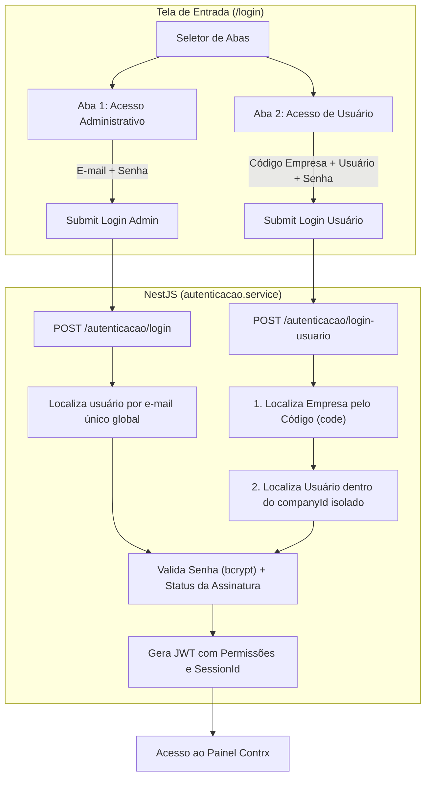

# Plano de Implementação: Tela de Entrada com Login por Código da Empresa e Usuário

> **Documento de Especificação Técnica e Guia de Implementação**  
> **Sistema**: Contrx ERP SaaS  
> **Módulos Afetados**: Autenticação, Multi-tenancy, Configurações de Usuários, Frontend e Backend.  
> **Status**: Especificação pronta para execução (Fase de Planejamento aprovada).

---

## 1. Visão Geral e Arquitetura da Solução

O objetivo desta implementação é modernizar a tela de entrada (`/login`) do Contrx para atender ao modelo clássico e consagrado de grandes sistemas ERP SaaS corporativos:
1. **Acesso Administrativo**: Login direto com **E-mail** e **Senha** (voltado para o proprietário da conta / assinante principal).
2. **Acesso de Usuário**: Login através de **Código da Empresa** + **Nome de Usuário** + **Senha** (voltado para colaboradores, atendentes, vendedores e operadores).



---

## 2. Alterações no Banco de Dados (Prisma / PostgreSQL)

### 2.1. Arquivo: `contrx-backend/prisma/schema.prisma`

#### Modelo `Company`:
Adicionar o campo `code` (código legível e amigável da empresa, único, em caixa alta):

```prisma
model Company {
  id                 String             @id @default(uuid())
  code               String             @unique @map("codigo_empresa") // Ex: "CTX-8492" ou "FCL-QMNLPA2C"
  tradeName          String             @map("nome_fantasia")
  companyName        String?            @map("razao_social")
  // ... demais campos existentes preservados
  
  users              User[]
  // ... relacionamentos existentes
  
  @@map("empresas")
}
```

#### Modelo `User`:
Adicionar o campo `username` com restrição de unicidade composta por empresa:

```prisma
model User {
  id                      String    @id @default(uuid())
  companyId               String    @map("empresa_id")
  name                    String    @map("nome")
  username                String?   @map("usuario_login") // Ex: "luan", "caixa01", "vendas"
  email                   String    @unique
  passwordHash            String    @map("senha_hash")
  
  role                    UserRole  @default(USER) @map("papel")
  isActive                Boolean   @default(true) @map("ativo")
  permissions             Json?     @map("permissoes")
  // ... demais campos existentes preservados

  company                 Company   @relation(fields: [companyId], references: [id])

  @@unique([companyId, username]) // Unicidade de login restrita à própria empresa
  @@index([companyId, username])
  @@map("usuarios")
}
```

### 2.2. Script SQL de Migração e Retrocompatibilidade

Para garantir que empresas já cadastradas não fiquem sem código:

```sql
-- 1. Adicionar a coluna de código na tabela empresas se não existir
ALTER TABLE empresas ADD COLUMN IF NOT EXISTS codigo_empresa VARCHAR(20);

-- 2. Gerar códigos únicos para empresas existentes que estejam nulas
UPDATE empresas 
SET codigo_empresa = 'CTX-' || UPPER(SUBSTRING(MD5(id::text || clock_timestamp()::text) FROM 1 FOR 6))
WHERE codigo_empresa IS NULL;

-- 3. Definir a coluna como NOT NULL e UNIQUE
ALTER TABLE empresas ALTER COLUMN codigo_empresa SET NOT NULL;
CREATE UNIQUE INDEX IF NOT EXISTS uq_empresas_codigo_empresa ON empresas (codigo_empresa);

-- 4. Adicionar a coluna de nome de usuário na tabela usuarios
ALTER TABLE usuarios ADD COLUMN IF NOT EXISTS usuario_login VARCHAR(60);

-- 5. Preencher usuario_login padrão a partir do prefixo do e-mail para usuários existentes
UPDATE usuarios 
SET usuario_login = LOWER(SPLIT_PART(email, '@', 1))
WHERE usuario_login IS NULL;

-- 6. Criar índice único composto (empresa_id + usuario_login)
CREATE UNIQUE INDEX IF NOT EXISTS uq_usuarios_empresa_usuario ON usuarios (empresa_id, usuario_login);
```

---

## 3. Backend (NestJS / `contrx-backend`)

### 3.1. DTO de Login do Usuário de Empresa
Arquivo: `contrx-backend/src/autenticacao/dto/login-empresa-usuario.dto.ts`

```typescript
import { IsNotEmpty, IsString, Length, Matches } from 'class-validator';

export class LoginEmpresaUsuarioDto {
  @IsString({ message: 'Código da empresa inválido.' })
  @IsNotEmpty({ message: 'Informe o código da empresa.' })
  @Length(3, 30, { message: 'O código da empresa deve ter entre 3 e 30 caracteres.' })
  companyCode: string;

  @IsString({ message: 'Informe o usuário de acesso.' })
  @IsNotEmpty({ message: 'Informe o usuário ou e-mail.' })
  @Length(2, 80, { message: 'O usuário deve ter ao menos 2 caracteres.' })
  username: string;

  @IsString({ message: 'Senha inválida.' })
  @IsNotEmpty({ message: 'Informe a senha.' })
  password: string;
}
```

### 3.2. Serviço de Autenticação
Arquivo: `contrx-backend/src/autenticacao/autenticacao.service.ts`

#### Adicionar método `loginCompanyUser`:

```typescript
async loginCompanyUser(data: LoginEmpresaUsuarioDto) {
  const normalizedCompanyCode = data.companyCode.trim().toUpperCase();
  const normalizedUsername = data.username.trim().toLowerCase();

  // 1. Localiza a empresa pelo código amigável
  const company = await this.prisma.company.findFirst({
    where: {
      code: normalizedCompanyCode,
    },
    select: {
      id: true,
      tradeName: true,
      isActive: true,
      subscriptionStatus: true,
      trialStartsAt: true,
      trialEndsAt: true,
      trialExtendedUntil: true,
      subscriptionEndsAt: true,
    },
  });

  if (!company) {
    throw new UnauthorizedException('Código da empresa não encontrado.');
  }

  if (!company.isActive) {
    throw new UnauthorizedException('Empresa desativada. Contate o administrador.');
  }

  // 2. Localiza o usuário estritamente dentro da empresa encontrada
  const user = await this.prisma.user.findFirst({
    where: {
      companyId: company.id,
      OR: [
        { username: normalizedUsername },
        { email: normalizedUsername }, // Permite usar tanto username quanto e-mail
      ],
    },
    include: {
      company: {
        select: {
          isActive: true,
          subscriptionStatus: true,
          trialStartsAt: true,
          trialEndsAt: true,
          trialExtendedUntil: true,
          subscriptionEndsAt: true,
        },
      },
    },
  });

  if (!user) {
    throw new UnauthorizedException('Usuário não encontrado nesta empresa.');
  }

  if (!user.isActive) {
    throw new UnauthorizedException('Usuário inativo. Contate o administrador.');
  }

  // 3. Validação segura de senha
  const passwordMatch = await bcrypt.compare(data.password, user.passwordHash);
  if (!passwordMatch) {
    throw new UnauthorizedException('Senha incorreta.');
  }

  // 4. Verificação de status de assinatura
  const accessState = getCompanyAccessState(user.company);
  if (!accessState.canAccess) {
    throw new UnauthorizedException(accessState.reason);
  }

  // 5. Gera sessão e token JWT idêntico ao login padrão
  const sessionId = randomUUID();
  clearUserAuthCache(user.id);

  const authenticatedUser = await this.prisma.user.update({
    where: { id: user.id },
    data: {
      activeSessionId: sessionId,
      lastLoginAt: new Date(),
    },
    include: {
      company: {
        select: {
          isActive: true,
          subscriptionStatus: true,
          trialStartsAt: true,
          trialEndsAt: true,
          trialExtendedUntil: true,
          subscriptionEndsAt: true,
        },
      },
    },
  });

  const token = await this.jwtService.signAsync({
    sub: authenticatedUser.id,
    email: authenticatedUser.email,
    companyId: authenticatedUser.companyId,
    role: authenticatedUser.role,
    sessionId,
  });

  return {
    accessToken: token,
    user: buildAuthenticatedUserPayload(authenticatedUser),
  };
}
```

### 3.3. Controller de Autenticação
Arquivo: `contrx-backend/src/autenticacao/autenticacao.controller.ts`

```typescript
@Post('login-usuario')
@UseGuards(RateLimitGuard)
async loginUsuario(@Body() body: LoginEmpresaUsuarioDto) {
  return this.autenticacaoService.loginCompanyUser(body);
}
```

### 3.4. Criação de Colaborador com Campo `username`
Atualizar `CriarUsuarioEmpresaDto` e `createCompanyUser`:
- Adicionar validação de `username?: string;`
- Caso não informado, derivar automaticamente do e-mail.
- Garantir que o `username` não contenha espaços nem caracteres especiais.

---

## 4. Frontend (Next.js / `contrx`)

### 4.1. Serviço de Autenticação no Frontend
Arquivo: `services/auth.ts`

```typescript
export interface LoginCompanyUserPayload {
  companyCode: string;
  username: string;
  password: string;
}

export async function loginCompanyUserRequest(data: LoginCompanyUserPayload) {
  const response = await fetch(`${API_URL}/autenticacao/login-usuario`, {
    method: 'POST',
    headers: { 'Content-Type': 'application/json' },
    body: JSON.stringify(data),
  });

  if (!response.ok) {
    const errorData = await response.json().catch(() => ({}));
    throw new Error(errorData.message || 'Falha ao autenticar usuário da empresa.');
  }

  return response.json();
}
```

### 4.2. Contexto de Autenticação
Arquivo: `context/AuthContext.tsx`

Adicionar o método `loginCompanyUser`:
```typescript
const loginCompanyUser = async (companyCode: string, username: string, password: string) => {
  setIsLoading(true);
  try {
    const data = await loginCompanyUserRequest({ companyCode, username, password });
    handleAuthSuccess(data);
  } finally {
    setIsLoading(false);
  }
};
```

### 4.3. Interface da Tela de Login
Arquivo: `app/login/page.tsx`

#### Estado do Modo de Login:
```typescript
const [loginMode, setLoginMode] = useState<'admin' | 'user'>('user');
const [companyCode, setCompanyCode] = useState('');
const [username, setUsername] = useState('');
```

#### Persistência do Código da Empresa no Navegador:
```typescript
useEffect(() => {
  const savedCompanyCode = localStorage.getItem('contrx_saved_company_code');
  if (savedCompanyCode) {
    setCompanyCode(savedCompanyCode);
  }
}, []);

// Ao efetuar login com sucesso:
localStorage.setItem('contrx_saved_company_code', companyCode.trim().toUpperCase());
```

#### Estrutura do Seletor de Abas (Segmented Control):
```tsx
<div className="grid grid-cols-2 rounded-2xl bg-slate-100 p-1.5 mb-6 text-sm font-bold">
  <button
    type="button"
    onClick={() => setLoginMode('admin')}
    className={`py-3 px-4 rounded-xl transition ${
      loginMode === 'admin'
        ? 'bg-white text-slate-900 shadow-sm font-black'
        : 'text-slate-500 hover:text-slate-800'
    }`}
  >
    Acesso administrativo
  </button>
  <button
    type="button"
    onClick={() => setLoginMode('user')}
    className={`py-3 px-4 rounded-xl transition ${
      loginMode === 'user'
        ? 'bg-emerald-600 text-white shadow-md font-black'
        : 'text-slate-500 hover:text-slate-800'
    }`}
  >
    Acesso de usuário
  </button>
</div>
```

#### Campos da Aba "Acesso de usuário":
```tsx
{loginMode === 'user' && (
  <div className="space-y-4">
    {/* Campo Código da Empresa */}
    <div className="space-y-1">
      <label className="text-xs font-black uppercase text-slate-600">Código da empresa</label>
      <div className="flex h-[56px] items-center rounded-2xl border border-slate-200 bg-white px-4 shadow-sm focus-within:border-emerald-500 focus-within:ring-2 focus-within:ring-emerald-100">
        <Building2 className="text-slate-400 mr-3" size={20} />
        <input
          type="text"
          value={companyCode}
          onChange={(e) => setCompanyCode(e.target.value.toUpperCase())}
          placeholder="Ex: CTX-8492"
          className="w-full font-bold uppercase tracking-wider text-slate-800 outline-none"
        />
      </div>
    </div>

    {/* Campo Usuário */}
    <div className="space-y-1">
      <label className="text-xs font-black uppercase text-slate-600">Usuário</label>
      <div className="flex h-[56px] items-center rounded-2xl border border-slate-200 bg-white px-4 shadow-sm focus-within:border-emerald-500 focus-within:ring-2 focus-within:ring-emerald-100">
        <User className="text-slate-400 mr-3" size={20} />
        <input
          type="text"
          value={username}
          onChange={(e) => setUsername(e.target.value)}
          placeholder="Ex: Luan ou seu e-mail"
          className="w-full font-bold text-slate-800 outline-none"
        />
      </div>
    </div>

    {/* Campo Senha */}
    <div className="space-y-1">
      <label className="text-xs font-black uppercase text-slate-600">Senha</label>
      <div className="flex h-[56px] items-center rounded-2xl border border-slate-200 bg-white px-4 shadow-sm focus-within:border-emerald-500 focus-within:ring-2 focus-within:ring-emerald-100">
        <LockKeyhole className="text-slate-400 mr-3" size={20} />
        <input
          type={showPassword ? 'text' : 'password'}
          value={password}
          onChange={(e) => setPassword(e.target.value)}
          placeholder="Sua senha"
          className="w-full font-bold text-slate-800 outline-none"
        />
        <button
          type="button"
          onClick={() => setShowPassword(!showPassword)}
          className="text-slate-400 hover:text-slate-600 p-1"
        >
          {showPassword ? <EyeOff size={18} /> : <Eye size={18} />}
        </button>
      </div>
    </div>

    {/* Botão Entrar no Sistema */}
    <button
      type="button"
      onClick={handleCompanyUserLogin}
      disabled={isSubmitting}
      className="flex h-[56px] w-full items-center justify-center gap-2 rounded-2xl bg-emerald-700 text-white font-black text-base shadow-lg shadow-emerald-700/25 transition hover:bg-emerald-800 disabled:opacity-50"
    >
      <LockKeyhole size={18} />
      {isSubmitting ? 'Entrando...' : 'Entrar no sistema'}
    </button>
  </div>
)}
```

---

## 5. Gerenciamento nas Configurações da Empresa

Arquivo: `app/configuracoes/components/UserSettingsTab.tsx` e `CompanySettingsTab.tsx`

1. **Card de Identificação da Empresa**:
   - Um bloco visual de destaque exibindo:
     - 🏢 **Código da Sua Empresa: `CTX-8492`**
     - Botão `[Copiar Código]` com confirmação rápida (*"Código copiado!"*).
     - Texto de apoio: *"Informe este código para que seus funcionários acessem o sistema pelo 'Acesso de Usuário'."*

2. **Formulário de Cadastro de Novo Usuário**:
   - Adicionar o campo opcional:
     - **Usuário de Acesso (Login)**: `[ Ex: luan ]`
     - Caso o gestor deixe em branco, o sistema sugere automaticamente com base no nome ou e-mail.

---

## 6. Checklist de Segurança e Validação Multi-empresa

- [x] **Isolamento de Tenants**: A busca do usuário no endpoint `/login-usuario` utiliza obrigatoriamente `companyId: company.id`. É impossível que um usuário de uma empresa acesse os dados de outra.
- [x] **Prevenção de Ataques de Enumeração**: Mensagens de erro padronizadas não expõem detalhes desnecessários.
- [x] **Rate Limiting**: O endpoint `/login-usuario` conta com `RateLimitGuard` contra tentativas repetitivas de força bruta por IP e por empresa.
- [x] **Compatibilidade com Usuários Existentes**: Contas de donos/proprietários continuam fazendo login diretamente por e-mail na aba "Acesso Administrativo".
- [x] **Construção e Build**: Antes de publicar, realizar validação local com `npm run build` no frontend e `npm run build` no backend.

---

*Documento gerado e catalogado em `docs/plano-implementacao-login-usuario-empresa.md`.*
